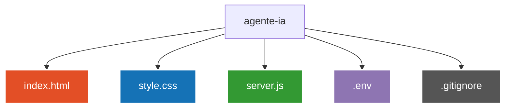

# 🤖 S.E.X.T.A.-F.E.I.R.A. 


> Uma assistente virtual interativa inspirada na IA do Homem de Ferro, integrando o modelo Gemini da Google com APIs nativas do navegador para reconhecimento e síntese de voz em tempo real.

> [!NOTE]
> **🚧 Projeto em Desenvolvimento:** Esta é a versão base (v1.0) da assistente. Novas rotas, integração com automações locais e aprimoramentos de interface estão em constante implementação.

---

## 💻 Sobre o Projeto

A **S.E.X.T.A.-F.E.I.R.A.** é um projeto full-stack local que conecta uma interface visual moderna a um servidor Node.js intermediário alimentado pelo SDK oficial do Google Gemini.

A aplicação escuta os comandos do usuário através do microfone, converte a fala em texto via **Web Speech Recognition API**, envia o prompt para o backend, processa a resposta com a personalidade ajustada da assistente e responde ao usuário utilizando síntese de voz nativa (**SpeechSynthesis API**).

---

## ⚙️ Funcionalidades

- **Reconhecimento de Voz:** Captura contínua e precisa de áudio do microfone via navegador em português (`pt-BR`).
- **Comunicação com IA em Tempo Real:** Conexão assíncrona (`fetch` / REST API) com o backend Node.js.
- **Personalidade Customizada:** Respostas diretas, concisas e otimizadas para leitura por voz através de *System Instructions* no Gemini.
- **Resposta em Áudio (TTS):** Síntese de voz em tempo real que lê as respostas da assistente.
- **Interface Futurista:** Design temático estilo *Core/Arc Reactor*, com feedback visual de estado (modo escuta e processamento).

---

## 🛠️ Tecnologias Utilizadas

- **HTML5:** Estruturação da interface, botão interativo e container de status.
- **CSS3:** Estilização futurista com temas em *dark mode*, animações e efeitos em *glow*.
- **JavaScript (Vanilla & Node.js):**
  - **Web Speech API:** Interface `SpeechRecognition` para áudio-texto e `SpeechSynthesis` para texto-áudio.
  - **Express.js:** Criação de rotas HTTP e gerenciamento de requisições `POST`.
  - **Dotenv:** Gerenciamento seguro de variáveis de ambiente locais.
  - **@google/genai:** SDK oficial da Google para integração com o modelo `gemini-1.5-flash`.

---

## 🚀 Como Executar o Projeto Localmente

### Pré-requisitos
- [Node.js](https://nodejs.org) instalado na máquina.
- Extensão **Live Server** instalada no VS Code.
- Uma chave de API gratuita do [Google AI Studio](https://aistudio.google.com).

### ☕ Passo a Passo

1. **Clone o repositório:**
   ```bash
   git clone https://github.com/AliceSilva2012/agente-ia.git
   ```
2. **Acesse a pasta do projeto:**
   ```bash
   cd agente-ia
   ```
   
3. **Instale as dependências do Node.js:**
   ```bash
   npm install
   ```

4. **Inicie o servidor Backend:**
   ```bash
   node server.js
   ```

5. **Inicie a interface Frontend:**

- Clique com o botão direito no arquivo index.html e selecione Open with Live Server.

- Conceda a permissão de uso do microfone ao navegador.

- Clique no botão LIGAR CORE e comece a interagir!

---

## 📁 Estrutura de Arquivos


