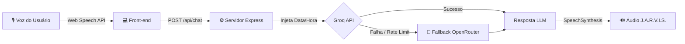

# 🤖 J.A.R.V.I.S.


CI](https://github.com/AliceSilva2012/agente-ia/actions/workflows/node.js.yml/badge.svg)](https://github.com/AliceSilva2012/teste_node-js/actions/workflows/node.js.yml)

> Um assistente virtual interativo inspirado na IA do Homem de Ferro, combinando uma interface visual com **Reator Arc dinâmico**, inferência ultrarrápida via **Groq API** (`openai/gpt-oss-120b`), **fallback automático para OpenRouter API** e APIs nativas do navegador para reconhecimento e síntese de voz em tempo real.

> [!NOTE]
> **⚡ Arquitetura v1.2:** Nova interface visual com **Reator Arc** interativo que alterna dinamicamente entre azul (standby) e vermelho (modo escuta) via filtros CSS, além de back-end resiliente com failover automático entre Groq e OpenRouter e pipeline de CI no GitHub Actions.

---

## 💻 Sobre o Projeto

O **J.A.R.V.I.S.** é uma aplicação full-stack local que conecta uma interface futurista a um servidor intermediário em Node.js e Express.

A aplicação captura os comandos de voz do usuário pelo microfone em tempo real via **Web Speech Recognition API**, injeta dinamicamente o contexto de data e hora local no *system prompt* do back-end, consulta o modelo de linguagem principal na **Groq** (acionando o **OpenRouter** automaticamente em caso de falha) e devolve a resposta em áudio utilizando a **SpeechSynthesis API** com prioridade para vozes masculinas do sistema.

---

## ⚙️ Funcionalidades

- **Interface Reator Arc Dinâmica:** Botão central com imagem do Reator Arc recortada em CSS (`clip-path`) e transição suave para vermelho (`filter: hue-rotate`) durante a captura de áudio.
- **Reconhecimento de Voz em Tempo Real:** Captura de fala pelo microfone via navegador em português (`pt-BR`).
- **Motor Principal via Groq API:** Processamento rápido utilizando o modelo `openai/gpt-oss-120b` com `max_tokens` calibrado para respostas completas sem cortes.
- **Fallback Automático (Contingência):** Caso a API principal falhe ou atinja o limite de uso, o servidor redireciona a requisição automaticamente para o **OpenRouter**.
- **Data e Hora Sincronizadas:** Injeção dinâmica do relógio e calendário do sistema no prompt a cada requisição.
- **Síntese de Voz Masculina (TTS):** Carregamento assíncrono das vozes do sistema operacional com filtro prioritário para vozes masculinas e ajuste de tom grave como alternativa.

---

## 🛠️ Tecnologias Utilizadas

- **HTML5:** Estruturação da interface, botão interativo do Reator Arc e legenda de transcrição/resposta.
- **CSS3:** Estilização *dark mode*, efeitos *glow*, `clip-path` circular e manipulação dinâmica de cores com `filter: hue-rotate()`.
- **JavaScript (Vanilla & Node.js):**
  - **Web Speech API:** `SpeechRecognition` para transcrição de voz e `SpeechSynthesis` para leitura das respostas.
  - **Express.js & CORS:** Servidor HTTP e gerenciamento da rota `POST /api/chat`.
  - **Dotenv:** Gerenciamento seguro das chaves de API via variáveis de ambiente.
  - **Groq API & OpenRouter API:** Arquitetura resiliente de LLMs com failover automático.
- **GitHub Actions:** Pipeline de integração contínua (`node.js.yml`) para validação automática do servidor.

---

## 🚀 Como Executar o Projeto Localmente

### Pré-requisitos
- [Node.js](https://nodejs.org) (v18 ou superior recomendada) instalado na máquina.
- Extensão **Live Server** instalada no VS Code.
- Uma chave de API gratuita da [Groq](https://console.groq.com) e opcionalmente do [OpenRouter](https://openrouter.ai) para fallback (crie sua própria conta).

### ☕ Passo a Passo

1. **Clone o repositório:**
   ```bash
   git clone https://github.com/AliceSilva2012/agente-ia.git
   ```

2. **Acesse a pasta do projeto:**
   ```bash
   cd agente-ia
   ```

3. **Instale as dependências do Node.js:**
   ```bash
   npm install
   ```

4. **Configure as variáveis de ambiente:**
   Crie um arquivo `.env` na raiz do projeto com suas chaves de API:
   ```bash
   # Obrigatória
   GROQ_API_KEY=sua_chave_aqui
   # Opcional: utilizada como fallback
   OPENROUTER_API_KEY=sua_chave_aqui
   ```

5. **Inicie o servidor Back-end:**
   ```bash
   node server.js
   ```

6. **Inicie a interface Front-end:**
   - Clique com o botão direito no arquivo `index.html` e selecione **Open with Live Server**.
   - Conceda a permissão de uso do microfone ao navegador.
   - Clique no **Reator Arc** e comece a conversar com o J.A.R.V.I.S.!

---

> [!WARNING]
>  **‼️ Detalhes importantes sobre o projeto:**
> - O reconhecimento de voz depende do suporte do navegador à **Web Speech API**.
> - A disponibilidade de vozes varia conforme o sistema operacional e o navegador (Chrome, Edge, Safari, Firefox, etc.).
> - É necessário conceder permissão de acesso ao microfone.
---

## 🧠 Fluxo da Arquitetura



---

## 📁 Estrutura de Arquivos

```text
agente-ia/
├── .github/
│   └── workflows/
│       └── node.js.yml      # Pipeline de CI/CD no GitHub Actions
├── img/
│   └── reactor.png          # Imagem base do Reator Arc
├── .env                     # Chaves de API locais (Groq e OpenRouter)
├── .gitignore               # Arquivos ignorados pelo Git (node_modules, .env)
├── index.html               # Interface principal e integração com Web Speech API
├── package.json             # Dependências e scripts (start e test)
├── package-lock.json        # Versões exatas das dependências
├── README.md                # Documentação do projeto
├── server.js                # Servidor Node.js/Express e rotas da IA
└── style.css                # Estilização, efeitos glow e filtros do Reator Arc
```
