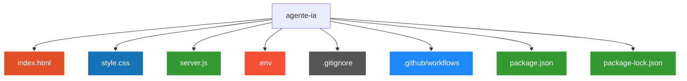

# 🤖 J.A.R.V.I.S.


> Um assistente virtual interativo inspirado na IA do Homem de Ferro, integrando inferência ultrarrápida via **Groq API** (`openai/gpt-oss-120b`) com **fallback automático para OpenRouter** e APIs nativas do navegador para reconhecimento e síntese de voz em tempo real.

> [!NOTE]
> **⚡ Arquitetura v1.1 (Alta Disponibilidade):** O motor de inteligência foi migrado para a **Groq API** para respostas de baixa latência, mantendo o **OpenRouter** como rota de contingência automática em caso de instabilidade ou limite de requisições.

---

## 💻 Sobre o Projeto

O **J.A.R.V.I.S.** é uma aplicação full-stack local que conecta uma interface visual futurista (*Reator Arc*) a um servidor intermediário em Node.js e Express.

A aplicação captura os comandos de voz do usuário pelo microfone em tempo real via **Web Speech Recognition API**, injeta dinamicamente o contexto de data e hora local no *system prompt* do back-end, consulta o modelo de IA principal na **Groq** (acionando o **OpenRouter** automaticamente caso ocorra qualquer falha) e devolve a resposta em áudio utilizando a **SpeechSynthesis API** com prioridade para vozes masculinas do sistema (porém, alguns navegadores acabam optando pela voz do próprio sistema operacional da máquina).

---

## ⚙️ Funcionalidades

- **Reconhecimento de Voz em Tempo Real:** Captura de áudio pelo microfone via navegador em português (`pt-BR`).
- **Motor Principal via Groq API:** Processamento rápido utilizando o modelo `openai/gpt-oss-120b` com `max_tokens` calibrado para respostas completas sem cortes.
- **Fallback Automático (Contingência):** Caso a API principal falhe ou atinja o limite de uso, o servidor redireciona a requisição automaticamente para o **OpenRouter**.
- **Data e Hora Sincronizadas:** Injeção dinâmica do relógio e calendário do sistema no prompt a cada requisição.
- **Personalidade Customizada:** Respostas corteses, diretas e elegantes no estilo J.A.R.V.I.S. (assistente pessoal do Homem de Ferro).
- **Síntese de Voz Masculina (TTS):** Carregamento assíncrono das vozes do sistema operacional com filtro prioritário para vozes masculinas (como *Felipe* no macOS / *Antonio*) e ajuste de tom grave como alternativa.
- **Interface Reator Arc:** Visual *dark mode* com animações neon e feedback visual de estado (escuta e processamento).

---

## 🛠️ Tecnologias Utilizadas

- **HTML5:** Estruturação da interface, botão interativo do Reator Arc e legenda de transcrição/resposta.
- **CSS3:** Estilização futurista em *dark mode*, animações de pulso e efeitos *glow*.
- **JavaScript (Vanilla & Node.js):**
  - **Web Speech API:** `SpeechRecognition` para transcrição de voz e `SpeechSynthesis` para leitura das respostas.
  - **Express.js & CORS:** Servidor HTTP e gerenciamento da rota `POST /api/chat`.
  - **Dotenv:** Gerenciamento seguro das chaves de API via variáveis de ambiente.
  - **Groq API & OpenRouter API:** Arquitetura resiliente de LLMs com failover automático.

---

## 🚀 Como Executar o Projeto Localmente

### Pré-requisitos
- [Node.js](https://nodejs.org) (v18 ou superior recomendada) instalado na máquina.
- Extensão **Live Server** instalada no VS Code.
- Uma chave de API gratuita da [Groq](https://console.groq.com) e opcionalmente do [OpenRouter](https://openrouter.ai) para fallback (crie uma conta).

### ☕ Passo a Passo

1. **Clone o repositório:**
   ```bash
   git clone https://github.com/AliceSilva2012/agente-ia.git
   ```

2. **Acesse a pasta do projeto:**
   ```bash
   cd agente-ia
   ```

3. **Instale as dependências do Node.js:**
   ```bash
   npm install
   ```

4. **Configure as variáveis de ambiente:**
Crie um arquivo .env na raiz do projeto com suas chaves de API:
```bash
GROQ_API_KEY=sua_chave_gsk_aqui
OPENROUTER_API_KEY=sua_chave_sk_or_v1_aqui
```

5. **Inicie o servidor Back-end:**
   ```bash
   node server.js
   ```

6. **Inicie a interface Front-end:**

- Clique com o botão direito no arquivo index.html e selecione Open with Live Server.
- Conceda a permissão de uso do microfone ao navegador.
- Clique em LIGAR REATOR ARC e comece a interagir!

---

## 📁 Estrutura de Arquivos


