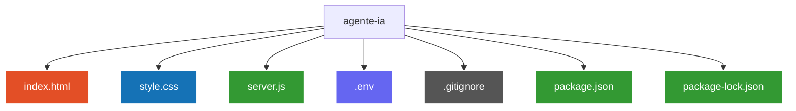

# 🤖 J.A.R.V.I.S.


> Um assistente virtual interativo inspirado na IA do Homem de Ferro, integrando o modelo Llama 3.2 da Meta via OpenRouter API com APIs nativas do navegador para reconhecimento e síntese de voz em tempo real.

> [!NOTE]
> **🚧 Projeto em Desenvolvimento:** Esta é a versão v1.0 do assistente. Novas rotas, sincronização de horário local dinâmico e aprimoramentos na seleção de voz masculina nativa estão configurados.

---

## 💻 Sobre o Projeto

O **J.A.R.V.I.S.** é um projeto full-stack local que conecta uma interface visual futurista a um servidor Node.js intermediário integrado à API do OpenRouter (`meta-llama/llama-3.2-1b-instruct`).

A aplicação escuta os comandos do usuário através do microfone, converte a fala em texto via **Web Speech Recognition API**, injeta dinamicamente o contexto de data/hora atual no back-end, processa a resposta com a personalidade refinada do assistente e responde ao usuário utilizando síntese de voz nativa masculina (**SpeechSynthesis API**).

---

## ⚙️ Funcionalidades

- **Reconhecimento de Voz:** Captura de áudio do microfone via navegador em português (`pt-BR`).
- **Comunicação com IA em Tempo Real:** Conexão assíncrona (`fetch` / REST API) com o backend Node.js e OpenRouter.
- **Data e Hora Sincronizadas:** Injeção dinâmica do relógio local no sistema prompt para respostas precisas de tempo e data.
- **Personalidade Customizada:** Respostas corteses, britânicas, elegantes e extremamente diretas (máximo 1 a 2 frases).
- **Resposta em Áudio Masculina (TTS):** Síntese de voz com filtros para seleção de vozes masculinas e tom grave estilo J.A.R.V.I.S.
- **Interface Futurista:** Design temático estilo *Core/Arc Reactor*, com feedback visual de estado (modo escuta e processamento).

---

## 🛠️ Tecnologias Utilizadas

- **HTML5:** Estruturação da interface, botão interativo e container de status.
- **CSS3:** Estilização futurista com temas em *dark mode*, animações e efeitos em *glow*.
- **JavaScript (Vanilla & Node.js):**
  - **Web Speech API:** Interface `SpeechRecognition` para áudio-texto e `SpeechSynthesis` para texto-áudio.
  - **Express.js:** Criação de rotas HTTP e gerenciamento de requisições `POST`.
  - **Dotenv:** Gerenciamento seguro de variáveis de ambiente locais.
  - **OpenRouter API:** Conexão com o modelo `meta-llama/llama-3.2-1b-instruct`.

---

## 🚀 Como Executar o Projeto Localmente

### Pré-requisitos
- [Node.js](https://nodejs.org) instalado na máquina.
- Extensão **Live Server** instalada no VS Code.
- Uma chave de API gratuita do [OpenRouter](https://openrouter.ai).

### ☕ Passo a Passo

1. **Clone o repositório:**
   ```bash
   git clone https://github.com/AliceSilva2012/agente-ia.git
   ```
2. **Acesse a pasta do projeto:**
   ```bash
   cd agente-ia
   ```
3. **Instale as dependências do Node.js:**
   ```bash
   npm install
   ```
4. **Configure as variáveis de ambiente:
Crie um arquivo .env na raiz do projeto com a sua chave da OpenRouter: (crie uma conta em [OpenRouter](https://openrouter.ai))**
  ```bash
  OPENROUTER_API_KEY= sua_chave_sk_or_v1_aqui
  ```
5. **Inicie o servidor Backend:**
   ```bash
   node server.js
   ```
6. **Inicie a interface Frontend:**
   - Clique com o botão direito no arquivo index.html e selecione Open with Live Server.
   - Conceda a permissão de uso do microfone ao navegador.
   - Clique no botão LIGAR CORE e comece a interagir!

---

## 📁 Estrutura de Arquivos


